## Video demostrativo

[](https://youtu.be/OWiT1kiuZtU)


| | |
|---|---|
| **Institución** | Instituto Tecnológico de las Américas (ITLA) |
| **Asignatura** | Seguridad de Redes |
| **Profesor** | Jonathan Esteban Rondon Corniel |
| **Estudiante** | Maxyohan Montas · matrícula 2025-0813 |
| **Fecha** | 6 de noviembre de 2026 |

## Contenido

- [Propósito del laboratorio](#propósito-del-laboratorio)
- [Requisitos y cómo se cumplen](#requisitos-y-cómo-se-cumplen)
- [Topología](#topología)
- [Diseño](#diseño)
- [Configuración](#configuración)
- [Pruebas y resultados](#pruebas-y-resultados)
- [Problemas y soluciones](#problemas-y-soluciones)
- [Running-configs y scripts](#running-configs-y-scripts)
- [Estructura del repositorio](#estructura-del-repositorio)
- [Conclusiones](#conclusiones)
- [Referencias](#referencias)

## Propósito del laboratorio

Tener **visibilidad de la red sin abrirla a cambios**: un servidor **Zabbix** recoge por **SNMP** el estado del router **R-0813** y del switch **SW-0813** (interfaces, tráfico, CPU, memoria, sensores, disponibilidad), y nadie más puede leer ni modificar esa información.

- **Direccionamiento.** La LAN 10.20.25.0/24 en la VLAN 13 sale de la matrícula 2025-0813. El router y el switch tienen IP fija.
- **DHCP.** R-0813 es el **servidor DHCP** de la LAN. El servidor Zabbix **ZBX-0813** es **cliente DHCP** y recibe siempre la 10.20.25.10 gracias a una **reserva por MAC**.
- **DHCP snooping.** SW-0813 solo deja pasar respuestas DHCP por el puerto del router, así que un servidor DHCP falso no puede repartir direcciones.
- **SNMP de solo lectura.** Los dos equipos tienen una **comunidad SNMP v2c de solo lectura** (RO) que, además, solo acepta consultas de 10.20.25.10 (`ACL-SNMP`).
- **Monitoreo.** Zabbix 7.0 LTS consulta los dos equipos con la plantilla *Cisco IOS by SNMP* y guarda la comunidad en una macro secreta.

## Requisitos y cómo se cumplen

| Requisito de la práctica | Cómo se cumple | Evidencia |
|---|---|---|
| Router y switch: direccionamiento IP | R-0813 Fa0/0 = 10.20.25.1/24 · SW-0813 SVI Vlan13 = 10.20.25.2/24 con gateway 10.20.25.1 | [07](docs/Evidencias/07-r-dhcp-binding.png) · [08](docs/Evidencias/08-sw-dhcp-snooping-y-vlan.png) · [11](docs/Evidencias/11-zabbix-hosts-snmp-disponible.png) |
| Servidor DHCP para la LAN | Pool `LAN-0813` en R-0813 (excluidas .1 a .9 y .11 a .20) y reserva `ZBX-0813` → 10.20.25.10; DHCP snooping en SW-0813 | [07](docs/Evidencias/07-r-dhcp-binding.png) · [08](docs/Evidencias/08-sw-dhcp-snooping-y-vlan.png) |
| Comunidad SNMP de solo lectura | `snmp-server community … RO ACL-SNMP` en los dos equipos; la ACL solo permite a 10.20.25.10 | [09](docs/Evidencias/09-zbx-snmpwalk-r-y-sw.png) · [11](docs/Evidencias/11-zabbix-hosts-snmp-disponible.png) |
| Servidor Zabbix | Ubuntu Server 24.04 + Zabbix 7.0.32 (MySQL y Apache) en una VM de VirtualBox añadida a GNS3 | [02](docs/Evidencias/02-ubuntu-instalacion-perfil.png) · [03](docs/Evidencias/03-zabbix-asistente-resumen.png) · [04](docs/Evidencias/04-zabbix-dashboard.png) |
| Zabbix como cliente DHCP | `enp0s3` por DHCP con `dhcp-identifier: mac` → 10.20.25.10/24 | [05](docs/Evidencias/05-zbx-netplan-dhcp.png) · [06](docs/Evidencias/06-zbx-ip-por-dhcp.png) |
| Verificar los datos SNMP en Zabbix del router y del switch | Hosts R-0813 y SW-0813 con SNMP disponible, 54 y 50 ítems, interfaces descubiertas | [11](docs/Evidencias/11-zabbix-hosts-snmp-disponible.png) · [12](docs/Evidencias/12-zabbix-datos-r-0813.png) · [13](docs/Evidencias/13-zabbix-datos-sw-0813.png) · [14](docs/Evidencias/14-zabbix-interfaces-descubiertas.png) |

## Topología

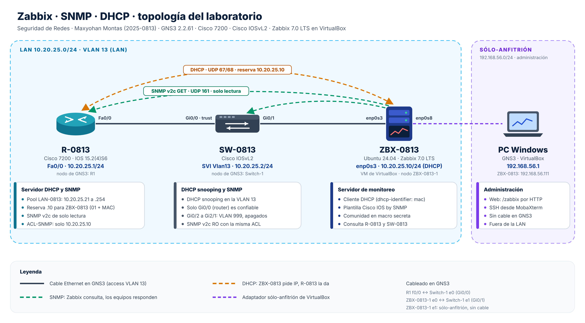

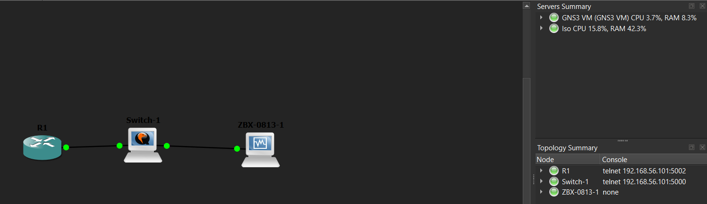

<p align="center"><em>Proyecto en GNS3. Los nodos conservan el nombre de la plantilla (R1, Switch-1, ZBX-0813-1); dentro de cada equipo el hostname es el de la práctica.</em></p>

### Cableado

| Nodo en GNS3 | Puerto | ↔ | Nodo en GNS3 | Puerto |
|---|---|:---:|---|---|
| R1 (R-0813) | f0/0 = FastEthernet0/0 | ↔ | Switch-1 (SW-0813) | e0 = GigabitEthernet0/0 |
| ZBX-0813-1 (ZBX-0813) | e0 = adaptador 1 (`enp0s3`) | ↔ | Switch-1 (SW-0813) | e1 = GigabitEthernet0/1 |
| ZBX-0813-1 (ZBX-0813) | e1 = adaptador 2 (`enp0s8`) | — | sin cable: sólo-anfitrión de VirtualBox | — |

### Direccionamiento

| Equipo | Interfaz | IP / máscara | Cómo la obtiene | Gateway |
|---|---|---|---|---|
| R-0813 | FastEthernet0/0 | 10.20.25.1/24 | Fija · es el servidor DHCP | — |
| SW-0813 | Vlan13 (SVI) | 10.20.25.2/24 | Fija | 10.20.25.1 |
| ZBX-0813 | `enp0s3` | 10.20.25.10/24 | **DHCP**, reserva por MAC 08:00:27:06:B9:0F | 10.20.25.1 |
| ZBX-0813 | `enp0s8` | 192.168.56.111/24 | DHCP de VirtualBox (sólo-anfitrión) | — |
| Otros clientes DHCP | — | 10.20.25.21 a .254 | Pool `LAN-0813` | 10.20.25.1 |

VLAN 13 `LAN` para los puertos en uso y VLAN 999 `NO-USADO` para los ocho puertos libres del switch (Gi0/2 a Gi2/1), que además quedan apagados.

### Plataforma

| Componente | Versión y detalle |
|---|---|
| Emulador | GNS3 2.2.61 con la GNS3 VM en VirtualBox |
| Router | Cisco 7200 (Dynamips) · IOS 15.2(4)S6 · nodo R1 |
| Switch | Cisco IOSvL2 15.2 (QEMU) · plantilla de 10 puertos · nodo Switch-1 |
| Servidor | Ubuntu Server 24.04.5 LTS en una VM de VirtualBox (2 vCPU, 2 GB, 20 GB) · Zabbix 7.0.32 LTS con MySQL 8.0 y Apache · nodo ZBX-0813-1 |
| Administración | Navegador y MobaXterm (SSH) en la PC con Windows, por la red sólo-anfitrión |

## Diseño

### DHCP con reserva y DHCP snooping

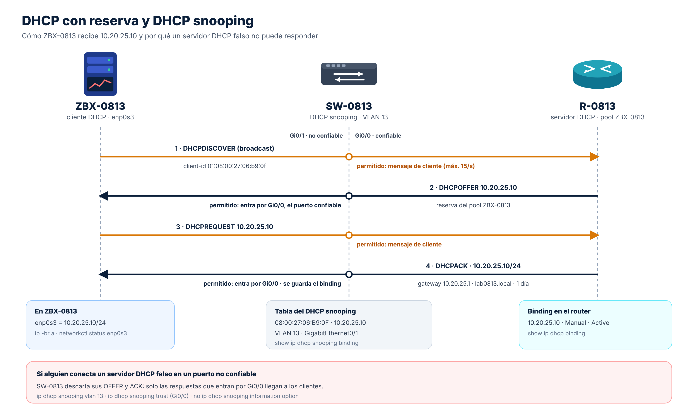

- La reserva usa el **client-identifier** `0108.0027.06b9.0f` (`01` + MAC). Ubuntu lo envía así porque netplan tiene `dhcp-identifier: mac`; sin esa línea se identificaría con otro tipo de ID y no coincidiría.
- La IP reservada **no puede estar en un rango excluido**: por eso se excluyen .1 a .9 y .11 a .20 y la .10 queda libre para la reserva.
- En SW-0813 solo **Gi0/0** (el router) es confiable. `no ip dhcp snooping information option` evita que el switch añada la opción 82, que el servidor DHCP del router descartaría.

### SNMP de solo lectura

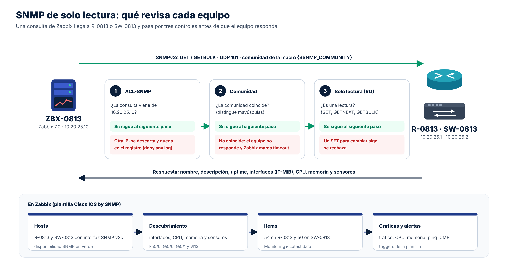

| Control | Configuración | Qué evita |
|---|---|---|
| Comunidad no predeterminada | `snmp-server community <COMUNIDAD-RO> …` (no `public`), solo letras y números | Que una herramienta pruebe la comunidad de fábrica |
| Solo lectura | `RO` | Que alguien con la comunidad cambie la configuración por SNMP |
| Solo Zabbix | `ACL-SNMP`: `permit 10.20.25.10` · `deny any log` | Que otro equipo de la LAN consulte, aunque conozca la comunidad |
| Comunidad oculta en Zabbix | Macro `{$SNMP_COMMUNITY}` de tipo *Secret text* | Que se vea en pantalla o en una exportación |

### Administración del servidor

La red de GNS3 está aislada de la PC, así que ZBX-0813 tiene un **segundo adaptador sólo-anfitrión** para la web de Zabbix y el SSH. En la plantilla de GNS3, la VM tiene **2 adaptadores** y la opción *Allow GNS3 to use any configured VirtualBox adapter* **desmarcada**: así GNS3 cablea el adaptador 1 (*No conectado*) y respeta el 2. Con un solo adaptador en la plantilla, GNS3 apagaría el sólo-anfitrión al arrancar la VM.

### Endurecimiento de los equipos Cisco

- `enable secret`, `service password-encryption` y `exec-timeout 10 0` en la consola.
- `no ip http server`, `no ip http secure-server`, `no ip domain-lookup` y aviso legal (`banner motd`).
- Switch: puertos sin uso en la VLAN 999 y apagados, `Vlan1` apagada, `switchport nonegotiate` en los puertos de acceso, `spanning-tree bpduguard enable` y límite de 15 paquetes DHCP por segundo en el puerto de Zabbix.

## Configuración

| Equipo | Qué se configuró | Script |
|---|---|---|
| **ZBX-0813** | Ubuntu Server, Zabbix 7.0 (servidor, web y agente), MySQL, Net-SNMP y la red como cliente DHCP | [`ZBX-0813_instalar-zabbix.sh`](scripts/ZBX-0813_instalar-zabbix.sh) · [`ZBX-0813_red.sh`](scripts/ZBX-0813_red.sh) |
| **R-0813** | Interfaz de la LAN, servidor DHCP con reserva, SNMP de solo lectura, endurecimiento | [`R-0813_config.txt`](scripts/R-0813_config.txt) |
| **SW-0813** | VLAN, puertos, IP de gestión, DHCP snooping, SNMP de solo lectura, endurecimiento | [`SW-0813_config.txt`](scripts/SW-0813_config.txt) |

### Servidor ZBX-0813

| Instalación de Ubuntu Server | Asistente web de Zabbix |
|:---:|:---:|
| 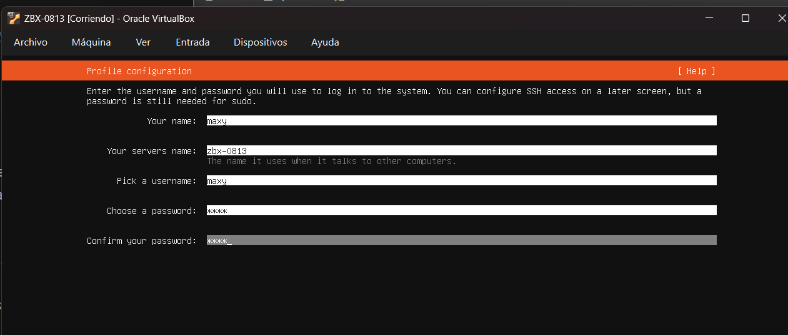 | 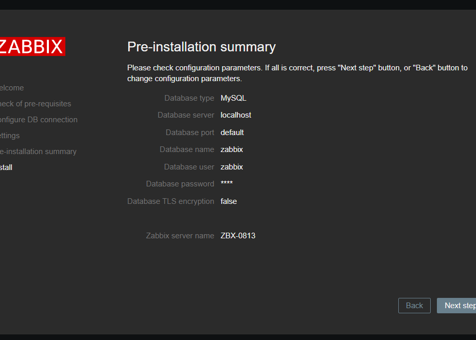 |

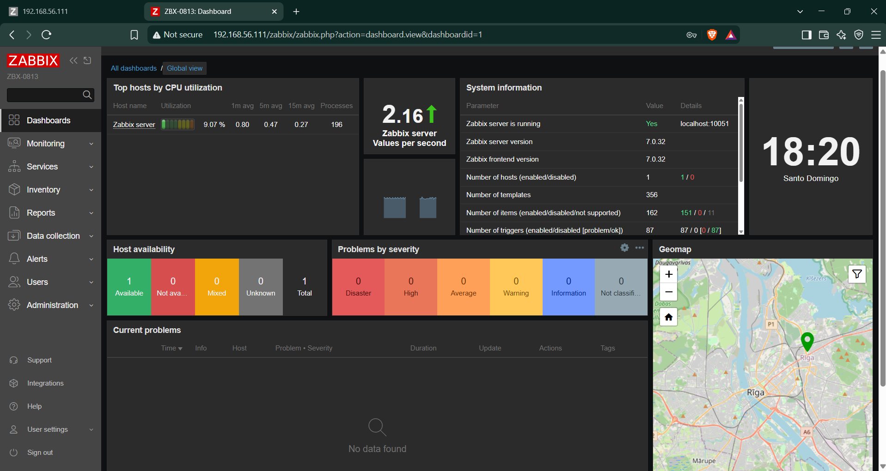

```yaml
# /etc/netplan/50-cloud-init.yaml
network:
  version: 2
  ethernets:
    enp0s3:              # LAN de GNS3 · cliente DHCP de R-0813
      dhcp4: true
      dhcp-identifier: mac
      optional: true
    enp0s8:              # sólo-anfitrión · web y SSH desde Windows
      dhcp4: true
```

Detalle completo: [`configs/ZBX-0813_config.md`](configs/ZBX-0813_config.md).

### Router R-0813 · servidor DHCP y SNMP

```
ip dhcp excluded-address 10.20.25.1 10.20.25.9
ip dhcp excluded-address 10.20.25.11 10.20.25.20
ip dhcp pool LAN-0813
 network 10.20.25.0 255.255.255.0
 default-router 10.20.25.1
 domain-name lab0813.local
 lease 1
ip dhcp pool ZBX-0813
 host 10.20.25.10 255.255.255.0
 client-identifier 0108.0027.06b9.0f
 default-router 10.20.25.1
 domain-name lab0813.local
!
ip access-list standard ACL-SNMP
 remark Solo ZBX-0813 consulta SNMP
 permit host 10.20.25.10
 deny any log
snmp-server community <COMUNIDAD-RO> RO ACL-SNMP
snmp-server location LAB0813 - GNS3 - R-0813
snmp-server contact Maxyohan Montas 2025-0813
snmp-server ifindex persist
```

### Switch SW-0813 · VLAN, DHCP snooping y SNMP

```
interface GigabitEthernet0/0
 description R-0813 Fa0/0 (servidor DHCP)
 switchport mode access
 switchport access vlan 13
 ip dhcp snooping trust
interface GigabitEthernet0/1
 description ZBX-0813 (Zabbix, cliente DHCP)
 switchport mode access
 switchport access vlan 13
 spanning-tree portfast
 spanning-tree bpduguard enable
 ip dhcp snooping limit rate 15
interface Vlan13
 ip address 10.20.25.2 255.255.255.0
ip default-gateway 10.20.25.1
!
ip dhcp snooping vlan 13
no ip dhcp snooping information option
ip dhcp snooping
!
snmp-server community <COMUNIDAD-RO> RO ACL-SNMP     (misma ACL-SNMP que el router)
```

### Zabbix · hosts R-0813 y SW-0813

| Host | Interfaz | Plantilla | Comunidad | Grupo |
|---|---|---|---|---|
| R-0813 | SNMP v2c · 10.20.25.1:161 | Cisco IOS by SNMP | `{$SNMP_COMMUNITY}` (*Secret text*) | Red LAB0813 |
| SW-0813 | SNMP v2c · 10.20.25.2:161 | Cisco IOS by SNMP | `{$SNMP_COMMUNITY}` (*Secret text*) | Red LAB0813 |

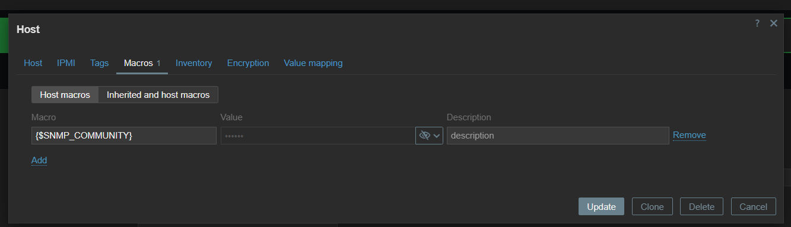

## Pruebas y resultados

| # | Prueba | Resultado obtenido | Evidencia |
|---|---|---|---|
| 1 | ZBX-0813 pide IP por DHCP dentro de GNS3 | `enp0s3` = **10.20.25.10/24** (dinámica, lease de un día) | [06](docs/Evidencias/06-zbx-ip-por-dhcp.png) |
| 2 | Binding en el servidor DHCP | `show ip dhcp binding` → 10.20.25.10 · `0108.0027.06b9.0f` · **Manual · Active** | [07](docs/Evidencias/07-r-dhcp-binding.png) |
| 3 | DHCP snooping en el switch | `show ip dhcp snooping binding` → 08:00:27:06:B9:0F · 10.20.25.10 · VLAN 13 · **Gi0/1** | [08](docs/Evidencias/08-sw-dhcp-snooping-y-vlan.png) |
| 4 | VLAN | VLAN 13 `LAN`: Gi0/0 y Gi0/1 · VLAN 999 `NO-USADO`: los ocho puertos libres | [08](docs/Evidencias/08-sw-dhcp-snooping-y-vlan.png) |
| 5 | SNMP desde el servidor | `snmpwalk` responde en los dos equipos: `R-0813.lab0813.local` (7200, 15.2(4)S6) y `SW-0813.lab0813.local` (vios_l2), con contacto y ubicación | [09](docs/Evidencias/09-zbx-snmpwalk-r-y-sw.png) |
| 6 | Disponibilidad en Zabbix | R-0813 y SW-0813 con **SNMP disponible** (verde): 54 y 50 ítems, 5 y 3 gráficas | [11](docs/Evidencias/11-zabbix-hosts-snmp-disponible.png) |
| 7 | Datos de R-0813 | CPU 0 %, fuentes *normal*, modelo **CISCO7206VXR**, memoria 6,5 %, temperatura 22 °C | [12](docs/Evidencias/12-zabbix-datos-r-0813.png) |
| 8 | Datos de SW-0813 | Ping ICMP *Up*, 28 ms de respuesta, Gi0/0 con 1,72 Kbps de entrada y 824 bps de salida | [13](docs/Evidencias/13-zabbix-datos-sw-0813.png) |
| 9 | Descubrimiento de interfaces | Fa0/0, Gi0/0, Gi0/1 y Vl13 con las descripciones configuradas en los equipos | [14](docs/Evidencias/14-zabbix-interfaces-descubiertas.png) |
| 10 | Comunidad incorrecta | Con la comunidad mal escrita (minúsculas), R-0813 no respondió y Zabbix marcó *timed out*; al corregirla volvió a verde | [15](docs/Evidencias/15-zabbix-r-snmp-timeout.png) · [11](docs/Evidencias/11-zabbix-hosts-snmp-disponible.png) |

| Binding del servidor DHCP (R-0813) | DHCP snooping y VLAN (SW-0813) |
|:---:|:---:|
| 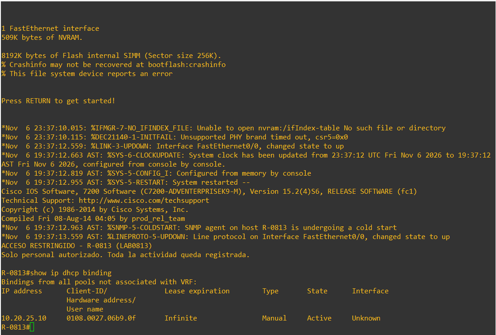 | 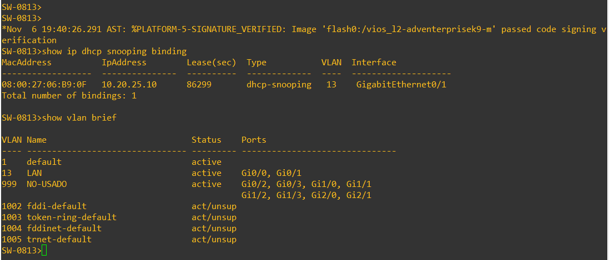 |

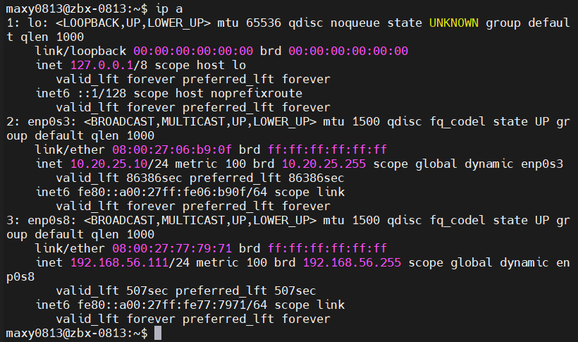

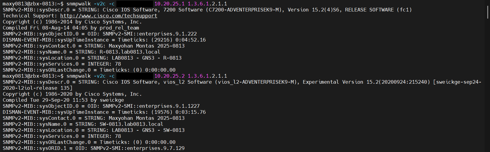

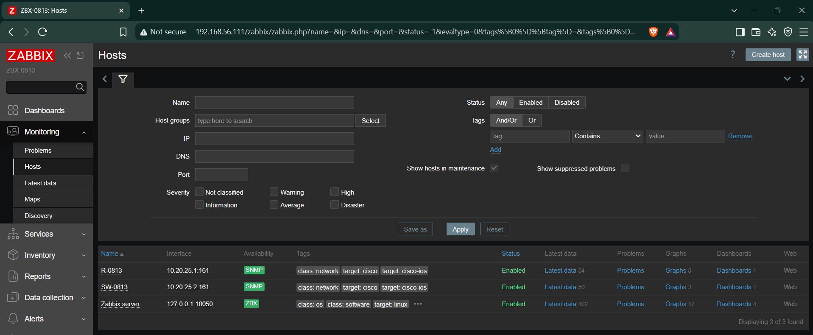

| Latest data · R-0813 | Latest data · SW-0813 |
|:---:|:---:|
| 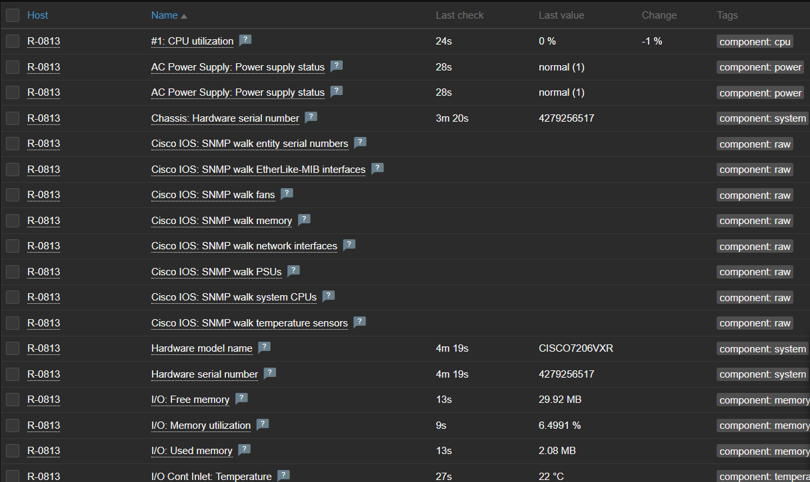 | 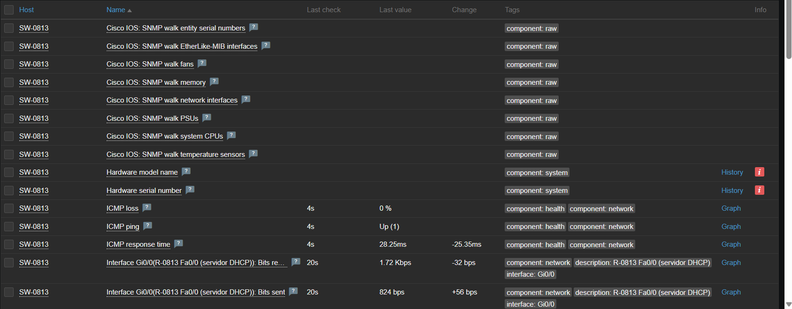 |

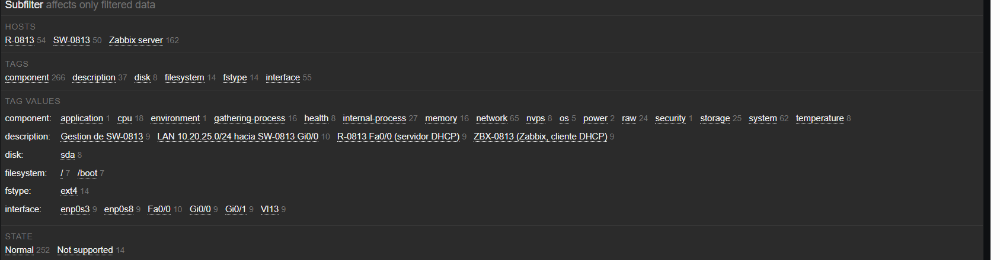

## Problemas y soluciones

| Problema | Causa | Solución |
|---|---|---|
| La web de Zabbix no abría (*tardó demasiado en responder*) | Se usaba una IP que no era la del adaptador sólo-anfitrión; la de NAT no se alcanza desde Windows | Abrir `http://192.168.56.111/zabbix`, la IP de `enp0s8` |
| *Incorrect user name or password or account is temporarily blocked* | El usuario es `Admin` con A mayúscula; tras varios fallos Zabbix bloquea la cuenta 30 s | Esperar el bloqueo y entrar con `Admin` |
| El netplan no se aplicó antes de pasar la VM a GNS3 | Se apagó la VM antes de pegar el bloque | Se aplicó por SSH en el primer arranque dentro de GNS3 y luego `sudo networkctl renew enp0s3` ([05](docs/Evidencias/05-zbx-netplan-dhcp.png)) |
| La GNS3 VM se caía con un *Guru Meditation* al encender el switch | IOSvL2 es el único nodo que usa KVM dentro de la GNS3 VM (virtualización anidada de VirtualBox) | Reiniciar la PC; después los tres equipos arrancaron sin problema |
| R-0813 en rojo en Zabbix: *cannot retrieve OID … timed out* | La macro `{$SNMP_COMMUNITY}` tenía la comunidad en minúsculas; SNMP distingue mayúsculas | Volver a escribir la macro con la comunidad exacta ([15](docs/Evidencias/15-zabbix-r-snmp-timeout.png) → [11](docs/Evidencias/11-zabbix-hosts-snmp-disponible.png)) |

## Running-configs y scripts

| Equipo | Running-config / configuración | Scripts |
|---|---|---|
| R-0813 | [`configs/R-0813_running-config.txt`](configs/R-0813_running-config.txt) | [`scripts/R-0813_config.txt`](scripts/R-0813_config.txt) |
| SW-0813 | [`configs/SW-0813_running-config.txt`](configs/SW-0813_running-config.txt) | [`scripts/SW-0813_config.txt`](scripts/SW-0813_config.txt) |
| ZBX-0813 | [`configs/ZBX-0813_config.md`](configs/ZBX-0813_config.md) · [`configs/ZBX-0813_netplan.yaml`](configs/ZBX-0813_netplan.yaml) | [`scripts/ZBX-0813_instalar-zabbix.sh`](scripts/ZBX-0813_instalar-zabbix.sh) · [`scripts/ZBX-0813_red.sh`](scripts/ZBX-0813_red.sh) · [`scripts/ZBX-0813_verificar-snmp.sh`](scripts/ZBX-0813_verificar-snmp.sh) |

- **Servidor:** primero `ZBX-0813_instalar-zabbix.sh` (con el adaptador 1 en NAT), luego `ZBX-0813_red.sh` ya dentro de GNS3. Las claves se escriben cuando el script las pide.
- **Router y switch:** cada bloque del `.txt` se pega en la consola, en orden (1 a 5), cambiando `<CLAVE-ENABLE>` y `<COMUNIDAD-RO>`.

## Estructura del repositorio

```
zabbix-snmp-dhcp-0813/
├── README.md
├── configs/
│   ├── R-0813_running-config.txt
│   ├── SW-0813_running-config.txt
│   ├── ZBX-0813_config.md
│   └── ZBX-0813_netplan.yaml
├── docs/
│   ├── Documentacion_Zabbix-SNMP-DHCP_2025-0813.pdf
│   ├── Documentacion_Zabbix-SNMP-DHCP_2025-0813.docx
│   ├── Diagramas/      portada del video, topología, flujo DHCP y flujo SNMP (PNG + fuente HTML)
│   └── Evidencias/     15 capturas numeradas (ver LEEME.md)
└── scripts/
    ├── ZBX-0813_instalar-zabbix.sh
    ├── ZBX-0813_red.sh
    ├── ZBX-0813_verificar-snmp.sh
    ├── R-0813_config.txt
    └── SW-0813_config.txt
```

**Seguridad del repositorio:** no se publican la comunidad SNMP, la clave de enable ni las contraseñas de Ubuntu, MySQL o Zabbix. En los scripts aparecen como `<COMUNIDAD-RO>` y `<CLAVE-ENABLE>`, en los running-configs como `<ELIMINADO>` y en las capturas están tapadas.

## Conclusiones

- **SNMP v2c de solo lectura con una ACL** permite monitorear sin abrir la red a cambios: Zabbix lee todo lo que necesita (interfaces, tráfico, CPU, memoria, sensores) y ningún otro equipo puede consultar ni escribir.
- La comunidad viaja en texto claro en SNMP v2c, por eso se compensa con **ACL, comunidad no predeterminada y macro secreta**; el siguiente paso natural sería SNMPv3 con autenticación y cifrado.
- La **reserva DHCP por client-identifier** da al servidor de monitoreo una IP estable sin configurarla a mano, y esa IP fija es la que permite cerrar la ACL de SNMP a un solo origen.
- **DHCP snooping** protege a todos los clientes de la LAN de un servidor DHCP falso y deja una tabla (MAC, IP, VLAN, puerto) útil para investigar.

## Referencias

- Zabbix · [Installation from packages (7.0)](https://www.zabbix.com/documentation/7.0/en/manual/installation/install_from_packages) · [Agente SNMP (7.0)](https://www.zabbix.com/documentation/7.0/es/manual/config/items/itemtypes/snmp) · [Ciclo de vida de versiones](https://www.zabbix.com/life_cycle_and_release_policy)
- Cisco · [Configuring the Cisco IOS DHCP Server](https://www.cisco.com/en/US/docs/ios/12_4t/ip_addr/configuration/guide/htdhcpsv.html) · [Operate and Troubleshoot DHCP Snooping](https://www.cisco.com/c/en/us/support/docs/ip/dynamic-host-configuration-protocol-dhcp-dhcpv6/217055-operate-and-troubleshoot-dhcp-snooping.html)
- Cisco Community · [Reserva DHCP dentro de un rango excluido](https://community.cisco.com/t5/switching/dhcp-manual-binding-clarification/m-p/2361928)
- Ubuntu · [Ubuntu 24.04 releases](https://releases.ubuntu.com/24.04/) · Netplan · [Referencia YAML (`dhcp-identifier`)](https://netplan.readthedocs.io/en/stable/netplan-yaml/)
- GNS3 · [virtualbox_vm.py: manejo de los adaptadores de VirtualBox](https://github.com/GNS3/gns3-server/blob/2.2/gns3server/compute/virtualbox/virtualbox_vm.py)
- ComputingForGeeks · [Zabbix 7.0 LTS en Ubuntu 24.04](https://computingforgeeks.com/install-and-configure-zabbix-lts-on-ubuntu/)
